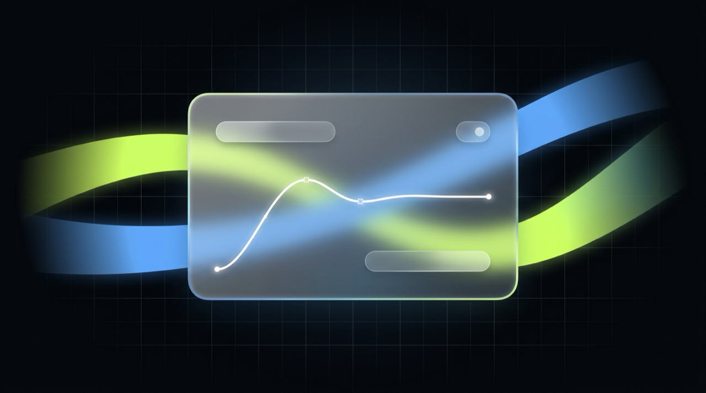

<p align="right"><strong>English</strong> · <a href="./README.md">中文</a></p>

# Motion Kit

[](./LICENSE)
[](https://wangjian-damon.github.io/motion-kit/demo/library.html)
[](#use-as-zero-dependency-primitives)
[](#development--verification)

<p align="center">
  <a href="https://wangjian-damon.github.io/motion-kit/demo/">
    
  </a>
</p>

**Framework-agnostic AI motion & interaction asset library + zero-dependency live showcase.**
66 battle-tested UI motion specs — covering product micro-interactions, AI-native streaming/voice UI, 9 native WebGL 3D shaders, true Z-axis 3D scenes, Liquid Glass, physics gestures, and data displays — with exact constants, state machines, degradation contracts, real browser pitfalls, and acceptance criteria.

- **Try Live First**: [**Interactive Landing Page**](https://wangjian-damon.github.io/motion-kit/demo/) · [**AI Asset Library (66 Live Mini-Stages)**](https://wangjian-damon.github.io/motion-kit/demo/library.html) · [3D & WebGL Showcase (22 Scenes)](https://wangjian-damon.github.io/motion-kit/demo/3d.html) · [Mobile Showcase](https://wangjian-damon.github.io/motion-kit/demo/mobile.html) · [Web Showcase](https://wangjian-damon.github.io/motion-kit/demo/web.html)
- **AI-Native Indexes**: [`llms.txt`](https://wangjian-damon.github.io/motion-kit/llms.txt) (drop directly into Cursor `@Docs` / Claude / Windsurf) · [`dist/registry.json`](https://wangjian-damon.github.io/motion-kit/dist/registry.json)

---

## Why Not Just Another Component Library?

| Traditional Motion Libraries | MotionKit |
|---|---|
| Locked to React, Framer Motion, or GSAP runtimes | **Framework-agnostic AI specs**: reproduce cleanly in React, Vue, Tailwind, Taro, Flutter, SwiftUI, or vanilla web |
| Ships code without explaining why constants exist | Every card documents **why each constant**, **degradation contracts**, **`pointercancel` & browser pitfalls**, and **acceptance tests** |
| Read docs in one tab, hunt demos in another | **WYSIWYG**: all 66 cards include live interactive mini-stages, `0.25×` slow-mo, reduced-motion simulator, and 1-click Skill / Cursor `.mdc` export |

---

## Quick Start

### 1. Use as an AI Agent Skill (Recommended — Any Stack, 1 Command)

Install once and let your AI coding agents (**Antigravity, Claude Code, Cursor, Codex**) automatically apply MotionKit's physics constants and edge-case protections whenever you ask for gestures, sheets, tables, or liquid glass — no manual prompt copying required:

```bash
# Global install (no repo clone needed, auto-detects installed Agents)
npx github:wangjian-damon/motion-kit install

# Team / project-level install (writes .agents/skills/motion-kit-apply for Git sharing)
npx github:wangjian-damon/motion-kit install --project

# Open Skills ecosystem compatible
npx skills add wangjian-damon/motion-kit --skill motion-kit-apply

# Inspect or export any framework-agnostic prompt from CLI
npx github:wangjian-damon/motion-kit list
npx github:wangjian-damon/motion-kit show bottom-sheet
```

### 2. Use as Zero-Dependency Primitives (Vue 3 / Taro / Vanilla Web)

```js
import MotionKit from './src/vue/index.js';
import './styles/motion.css';
import './styles/mobile.css';   // Touch vocabulary (optional)
import './styles/glass.css';    // Liquid Glass material layer (optional)
import './styles/3d.css';       // True Z-axis 3D layer (optional)

app.use(MotionKit);
```

See **[docs/API.md](./docs/API.md)** for all 37 Vue directives, Taro composables, tokens, and CSS classes, and **[docs/DESIGN.md](./docs/DESIGN.md)** for the 23 engineering design notes and known browser boundaries.

---

## 66 Cross-Platform Effect Specs (by Nature)

| Nature | Core Question | Shipped Cards |
|---|---|---|
| **Feedback** (11) | Did the UI receive my input? | `tap` · `long-press` · `context-menu` · `ripple` · `glass-tap` · `state-button` · `cell-flash` · `confetti` · `shader-ripple` · `tooltip-group` · `voice-wave` |
| **Continuity** (9) | Is this still the same element? | `bottom-sheet` · `pop` · `seg` · `shared-element` · `toast-stack` · `fluid-height` · `dynamic-pill` · `shader-terrain` · `shader-metaballs` |
| **Direction** (10) | Where did it come from / go? | `edge-back` · `swipe` · `sticky-title` · `scroll-fade` · `fold` · `fan` · `ring` · `tunnel` · `coverflow` · `shader-globe` |
| **Weight** (9) | How heavy does it feel? | `pull-refresh` · `detent` · `dock` · `snap-sheet` · `rubber-band` · `magnetic` · `mgrid` · `card-deck` · `shader-particles` |
| **Material** (14) | What is this surface made of? | `glass-base` · `refraction` · `tilt` · `spotlight` · `blob` · `border-run` · `cube` · `depth` · `sphere` · `book-3d` · `holo-card` · `shader-aurora` · `shader-orb` · `shader-torus` |
| **Rhythm** (13) | How do multiple items enter? | `enter` · `count-up` · `split` · `bar-grow` · `sparkline-draw` · `ai-stream` · `bounce-text` · `glitch` · `scramble` · `orbit` · `bar-3d` · `flip-clock` · `shader-dna` |

---

## Development & Verification

```bash
# Compile all 66 effect cards -> dist/registry.json, demo/registry.data.js, effects/INDEX.md, llms.txt & self-contained Skill, then run all 151 unit + leak tests
npm run check
```

---

## License

Licensed under the **[MIT License](./LICENSE)** © 2025–2026 Wangjian-damon.

> Credit: The rounded-rectangle SDF and displacement map prototype for edge refraction originates from [shuding/liquid-glass](https://github.com/shuding/liquid-glass) (MIT © 2025 Shu Ding), extended here with an SDF inward-normal vector field, dynamic element sizing, and geometry-pooled shared SVG filters.
