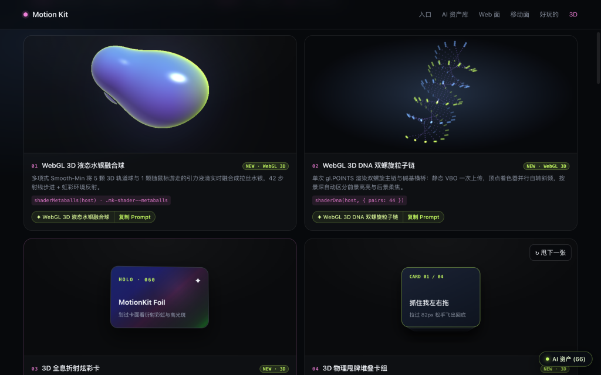
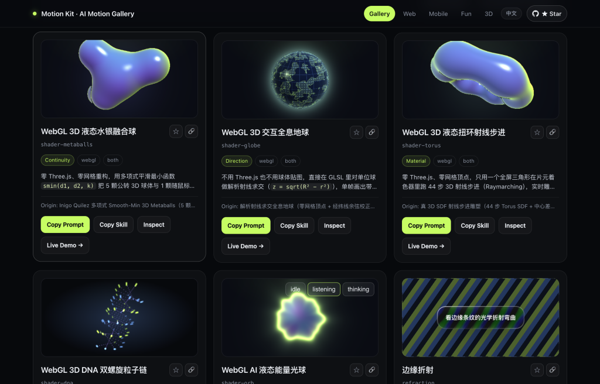

<p align="right"><strong>简体中文</strong> · <a href="./README.md">English</a></p>

# Motion Kit

[](./LICENSE)
[](https://wangjian-damon.github.io/motion-kit/demo/library.html?lang=zh)
[-a78bfa.svg)](https://wangjian-damon.github.io/motion-kit/demo/3d.html)
[](#方式-2作为零依赖前端原语引入vue-3--taro--原生-web)
[](#开发与校验)

<p align="center">
  <a href="https://wangjian-damon.github.io/motion-kit/demo/?lang=zh">
    
  </a>
</p>

**面向 AI 时代的跨平台动效灵感库 + 零依赖活体样本库。**
66 张去库化交互动效规范（涵盖**高频产品微交互**、**AI 原生流式/语音交互**、**9 款零 Three.js 原生 WebGL 3D Shader**、**真 Z 轴 3D**、**液态玻璃折射**、**物理手势**与**数据看板**），每张卡都附物理常量、降级契约、真实浏览器踩坑与验收标准，一键复制 **Prompt / Skill / Cursor `.mdc`**。

> **[✦ 逛 AI 动效灵感画廊（66 张原地可交互）](https://wangjian-damon.github.io/motion-kit/demo/library.html?lang=zh)** · **[3D 与 WebGL 展厅 (22 场景)](https://wangjian-damon.github.io/motion-kit/demo/3d.html)** · **[移动端展示面](https://wangjian-damon.github.io/motion-kit/demo/mobile.html)** · **[Web 端展示面](https://wangjian-damon.github.io/motion-kit/demo/web.html)** · **[`llms.txt`](https://wangjian-damon.github.io/motion-kit/llms.txt)**

---

## 实机预览画廊（浏览器真实渲染 · 0 外部依赖）

<table>
  <tr>
    <td width="50%">
      <a href="https://wangjian-damon.github.io/motion-kit/demo/3d.html">
        
      </a>
      <p align="center"><b>原生 WebGL 3D 与空间展厅（22 场景）</b><br/><sub>液态水银融合球 · DNA 双螺旋 · 全息地球 · 赛博地形 · 全息折射卡 · 3D 甩牌堆叠</sub></p>
    </td>
    <td width="50%">
      <a href="https://wangjian-damon.github.io/motion-kit/demo/library.html?lang=zh">
        
      </a>
      <p align="center"><b>AI 动效灵感画廊（66 张可交互规范）</b><br/><sub>按场景逛灵感 · 0.25× 慢放 · 降级模拟 · 一键导出 Prompt / Skill / Cursor <code>.mdc</code></sub></p>
    </td>
  </tr>
</table>

---

## 为什么不是又一个动效组件库

| 传统动效组件库 | MotionKit |
|---|---|
| 绑定 React / Framer Motion / GSAP 运行时 | **去库化 AI 资产**：任意技术栈（React / Vue / Tailwind / Taro / Flutter / SwiftUI）零幻觉复现 |
| 只给代码，不写参数依据与边界坑 | 每张卡写明**为什么是这个数**、**降级契约**、**`pointercancel` / Safari 实测坑**与**验收标准** |
| 引入几百 KB Three.js 与外部 3D 模型 | **9 款原生 WebGL 3D Shader**：0KB Three.js、DPR 1.5 封顶、离屏/后台双停帧与 Context 释放 |
| 看文档再跳去 Demo 找效果 | **所见即所得灵感画廊**：66 张卡原地可玩，支持按场景筛选、单卡直链分享、收藏夹与场景套件一键打包 |

---

## 快速开始

### 方式 1：作为 AI 动效资产使用（推荐，任意技术栈，一行安装）

执行一次安装，本机所有项目里的 AI Agent（**Cursor / Claude Code / Antigravity / Codex**）在遇到动效、手势、AI 对话流、数据看板、液态玻璃或 WebGL 3D 需求时，会自动按 MotionKit 标准复现，**无需手动复制提示词**：

```bash
# 全局安装（无需克隆仓库，自动探测本机 Agent）
npx github:wangjian-damon/motion-kit install

# 团队项目级安装（写入当前仓库 .agents/skills/，随 Git 共享）
npx github:wangjian-damon/motion-kit install --project

# 兼容开放 Skills 生态
npx skills add wangjian-damon/motion-kit --skill motion-kit-apply

# 终端速查 & 直接导出某张卡的去库化 Prompt
npx github:wangjian-damon/motion-kit list
npx github:wangjian-damon/motion-kit show shader-globe
```

也可以直接把 [`https://wangjian-damon.github.io/motion-kit/llms.txt`](https://wangjian-damon.github.io/motion-kit/llms.txt) 喂给 **Cursor `@Docs`** / **Claude** / **Windsurf**。

### 方式 2：作为零依赖前端原语引入（Vue 3 / Taro / 原生 Web）

```js
import MotionKit from './src/vue/index.js';
import './styles/motion.css';
import './styles/mobile.css';   // 移动端触控词汇（按需）
import './styles/glass.css';    // 液态玻璃材质层（按需）
import './styles/3d.css';       // 真 Z 轴 3D 层（按需）
import './styles/webgl.css';    // 原生 WebGL 3D Shader 层（按需）

app.use(MotionKit);
```

完整 Vue 指令、Taro 小程序适配、Token 体系与全部 CSS 类速查，请查看 **[docs/API.md](./docs/API.md)**；设计推导与双引擎实测见 **[docs/DESIGN.md](./docs/DESIGN.md)**。

---

## 66 张跨平台资产地图（按六大性质）

| 性质 | 回答的问题 | 已收录资产卡（点击 [AI 灵感库](https://wangjian-damon.github.io/motion-kit/demo/library.html?lang=zh) 在线体验与复制） |
|---|---|---|
| **反馈** (11) | 我的输入被接收了吗 | `tap` · `long-press` · `context-menu` · `ripple` · `glass-tap` · `state-button` · `cell-flash` · `confetti` · `shader-ripple` · `tooltip-group` · `voice-wave` |
| **连续** (9) | 这还是刚才那个东西吗 | `bottom-sheet` · `pop` · `seg` · `shared-element` · `toast-stack` · `fluid-height` · `dynamic-pill` · `shader-terrain` · `shader-metaballs` |
| **方向** (10) | 我从哪儿来、往哪儿去 | `edge-back` · `swipe` · `sticky-title` · `scroll-fade` · `fold` · `fan` · `ring` · `tunnel` · `coverflow` · `shader-globe` |
| **权重** (9) | 这东西有多重 | `pull-refresh` · `detent` · `dock` · `snap-sheet` · `rubber-band` · `magnetic` · `mgrid` · `card-deck` · `shader-particles` |
| **材质** (14) | 这表面是什么做的 | `glass-base` · `refraction` · `tilt` · `spotlight` · `blob` · `border-run` · `cube` · `depth` · `sphere` · `book-3d` · `holo-card` · `shader-aurora` · `shader-orb` · `shader-torus` |
| **节奏** (13) | 多元素按什么顺序出场 | `enter` · `count-up` · `split` · `bar-grow` · `sparkline-draw` · `ai-stream` · `bounce-text` · `glitch` · `scramble` · `orbit` · `bar-3d` · `flip-clock` · `shader-dna` |

完整按层/按性质自动同步索引见 [`effects/INDEX.md`](./effects/INDEX.md)。

---

## 开发与校验

```bash
# 编译 66 张卡片 → dist/registry.json + demo/registry.data.js + effects/INDEX.md + llms.txt + 自包含 Skill，并跑 151 项单测与零泄露门禁
npm run check

# 重新打包浏览器演示页全局包
npx esbuild demo/entry.js --bundle --format=iife --outfile=demo/motion-kit.global.js --minify
```

欢迎共建新动效卡！提交前请查看 **[CONTRIBUTING.md](./CONTRIBUTING.md)** 与 [`sources.md`](./sources.md)。

---

## License

本项目基于 **[MIT License](./LICENSE)** 开源 © 2025–2026 Wangjian-damon。

> 致谢：玻璃层边缘折射的圆角矩形 SDF 与位移图原型来自 [shuding/liquid-glass](https://github.com/shuding/liquid-glass)（MIT © 2025 Shu Ding），本库在此基础上改写了 SDF 内法线方向场、动态尺寸读取与按几何共享 filter 池。
